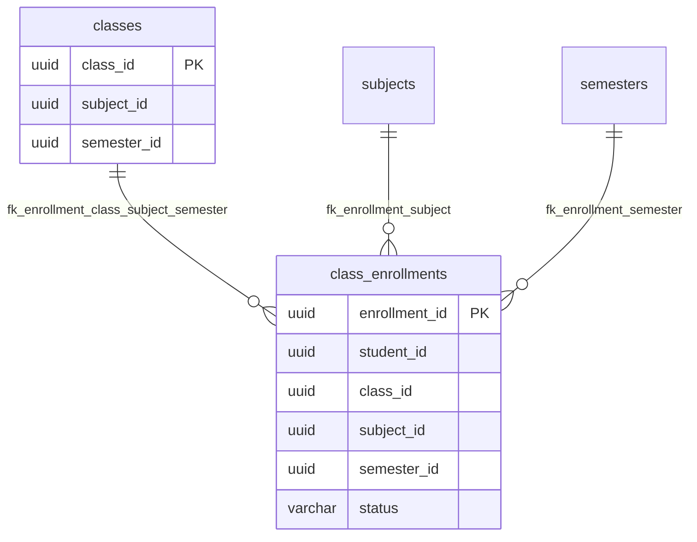
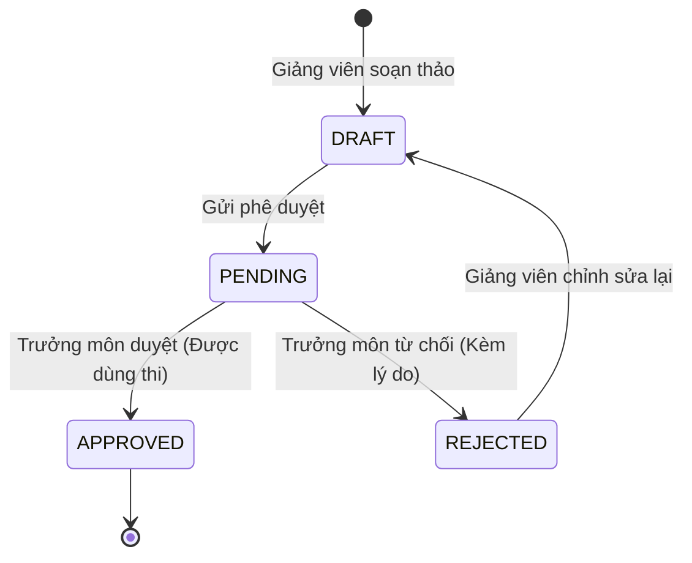
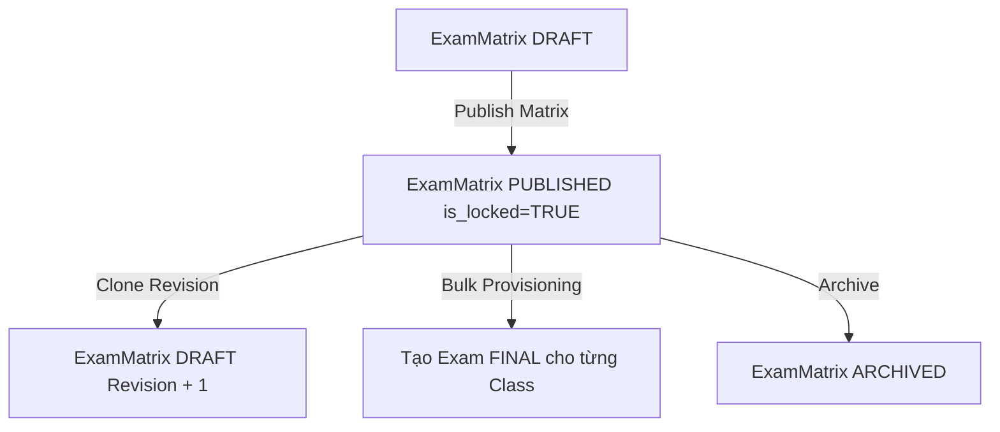
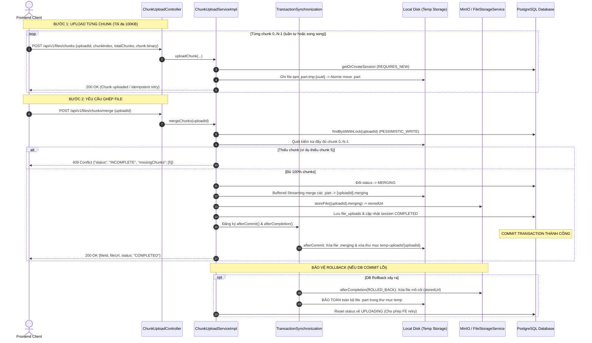
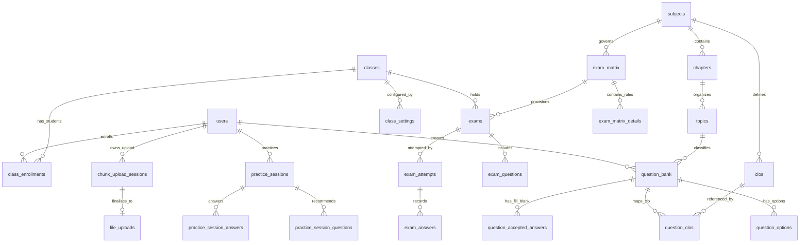

# HỆ THỐNG LMS VẬT LÝ — BACKEND MASTER ARCHITECTURE & CHANGELOG DOCUMENTATION

> **Phiên bản:** 1.0.0-PROD-AUDIT  
> **Ngày cập nhật:** 11/10/2026  
> **Trạng thái hệ thống:** Phase 0 → Phase 7 & Chunked File Upload Module Completed  
> **Nguyên tắc tài liệu:** Source Code & Git History là nguồn sự thật tối thượng (Source of Truth)  
> **Phạm vi:** Spring Boot 3.5, Hibernate 6, PostgreSQL Neon, MinIO Object Storage, Micro-architecture & Concurrency Control  

---

## MỤC LỤC CHI TIẾT

1. [Quy ước và Mức độ xác minh tài liệu](#1-quy-ước-và-mức-độ-xác-minh-tài-liệu)
2. [Phase 0 — Exam Safety & Core Exam Architecture](#2-phase-0--exam-safety--core-exam-architecture)
3. [Phase 1 — Enrollment Integrity (Toàn vẹn ghi danh lớp học)](#3-phase-1--enrollment-integrity-toàn-vẹn-ghi-danh-lớp-học)
4. [Phase 2 — CLO & QuestionBank Governance (Chuẩn đầu ra & Quản trị ngân hàng câu hỏi)](#4-phase-2--clo--questionbank-governance-chuẩn-đầu-ra--quản-trị-ngân-hàng-câu-hỏi)
5. [Phase 3 — Chapter / Topic Hierarchy (Phân cấp môn học - chương - chủ đề)](#5-phase-3--chapter--topic-hierarchy-phân-cấp-môn-học---chương---chủ-đề)
6. [Phase 4 — Scoped Learning Materials (Học liệu theo phạm vi Shared / Class)](#6-phase-4--scoped-learning-materials-học-liệu-theo-phạm-vi-shared--class)
7. [Phase 5 — Common FINAL Exam Matrix & Dinic Flow Scheduling](#7-phase-5--common-final-exam-matrix--dinic-flow-scheduling)
8. [Phase 6 — Learning Assessment & Adaptive Practice](#8-phase-6--learning-assessment--adaptive-practice)
9. [Phase 7 — Production Readiness & Critical Integrity Audit](#9-phase-7--production-readiness--critical-integrity-audit)
10. [Module độc lập — Chunked File Upload & Merge Streaming](#10-module-độc-lập--chunked-file-upload--merge-streaming)
11. [Kiến trúc Backend tổng thể hiện tại](#11-kiến-trúc-backend-tổng-thể-hiện-tại)
12. [Database Schema tổng thể & Entity Relationship](#12-database-schema-tổng-thể--entity-relationship)
13. [Danh mục REST API toàn hệ thống](#13-danh-mục-rest-api-toàn-hệ-thống)
14. [Các luồng nghiệp vụ End-to-End quan trọng](#14-các-luồng-nghiệp-vụ-end-to-end-quan-trọng)
15. [Tổng hợp Migration Scripts](#15-tổng-hợp-migration-scripts)
16. [Tổng hợp kết quả kiểm thử hệ thống](#16-tổng-hợp-kết-quả-kiểm-thử-hệ-thống)
17. [Tình trạng Git Repository & Uncommitted Changes](#17-tình-trạng-git-repository--uncommitted-changes)
18. [Ma trận rủi ro kỹ thuật còn tồn tại](#18-ma-trận-rủi-ro-kỹ-thuật-còn-tồn-tại)
19. [Checklist chuẩn bị triển khai Production](#19-checklist-chuẩn-bị-triển-khai-production)
20. [Hướng dẫn kỹ thuật cho lập trình viên kế thừa](#20-hướng-dẫn-kỹ-thuật-cho-lập-trình-viên-kế-thừa)

---

## 1. QUY ƯỚC VÀ MỨC ĐỘ XÁC MINH TÀI LIỆU

Nhằm đảm bảo tính chính xác khoa học, loại bỏ hoàn toàn các giả định suy đoán, tài liệu này áp dụng quy chuẩn 4 cấp độ xác minh:

| Ký hiệu | Cấp độ xác minh | Ý nghĩa phương pháp |
|---|---|---|
| `[VERIFIED FROM CODE]` | Xác minh trực tiếp từ mã nguồn | Được đối chiếu trực tiếp với các dòng code, annotations, entities, services, controllers hiện có trong `src/main/java`. |
| `[VERIFIED FROM GIT]` | Xác minh từ lịch sử Git | Được chứng minh thông qua `git log`, `git diff`, `git blame` hoặc commit tree tại repository. |
| `[REPORTED]` | Báo cáo kiểm thử / Nghiệm thu | Thông tin trích xuất từ các báo cáo nghiệm thu trước đây hoặc task logs (khi chưa thể re-run trực tiếp). |
| `[NOT VERIFIED]` | Chưa đủ bằng chứng tuyệt đối | Các tính năng giả định cần kiểm tra thêm ở môi trường production thực tế. |

> **BẢO MẬT DỮ LIỆU NHẠY CẢM:** Mọi chuỗi kết nối PostgreSQL Neon, JWT Secret, MinIO Credentials đều được che giấu dưới dạng biến môi trường `${SPRING_DATASOURCE_PASSWORD}`, `${JWT_SECRET}` để đảm bảo an toàn tuyệt đối.

---

## 2. PHASE 0 — EXAM SAFETY & CORE EXAM ARCHITECTURE

### A. Trạng thái trước khi thay đổi `[VERIFIED FROM GIT]`
- **Hiện trạng:** Hệ thống có module thi cử ban đầu gồm `Exam`, `ExamQuestion`, `ExamAttempt`, `ExamAnswer`.
- **Hạn chế kỹ thuật:**
  1. API lấy câu hỏi làm bài trả về toàn bộ dữ liệu thực của Entity `QuestionOption`, làm rò rỉ trường `isCorrect`, `explanation` trực tiếp xuống trình duyệt của sinh viên qua Network Payload.
  2. Không có cơ chế khóa đề thi khi đã có sinh viên nộp bài: Giáo viên có thể xóa đề thi đang diễn ra, làm treo hoặc mồ côi hàng loạt bản ghi `ExamAttempt` và `ExamAnswer`.
  3. Thiếu ràng buộc thời gian nộp bài: Sinh viên có thể nộp bài sau khi ca thi kết thúc cả tiếng đồng hồ nếu giữ kết nối HTTP.

### B. Mục tiêu của Phase
- Thiết lập cơ chế bảo mật bài thi chống gian lận (Anti-Cheat & Answer Leak Prevention).
- Bảo đảm tính bất biến của đề thi lịch sử khi đã phát sinh bài làm của sinh viên.

### C. Thay đổi kiến trúc `[VERIFIED FROM CODE]`
- Xây dựng tầng DTO chuyên biệt phục vụ sinh viên làm bài: `StudentExamQuestionDTO` và `StudentExamOptionDTO`. Tuyệt đối che giấu trường `isCorrect`, `correctAnswerText`, `explanation` khi đề thi chưa kết thúc và chưa có quyết định công bố đáp án.
- Thiết lập trạng thái `AttemptStatus` (`IN_PROGRESS`, `SUBMITTED`, `GRADED`, `EXPIRED`).

### D. Danh sách file tạo mới & chỉnh sửa `[VERIFIED FROM CODE]`

| File | Đường dẫn | Trạng thái | Vai trò chính |
|---|---|---|---|
| `StudentExamQuestionDTO.java` | `com.vatly1.example.model.dto` | Tạo mới/Sửa | DTO câu hỏi dành cho học sinh, ẩn hoàn toàn đáp án đúng. |
| `ExamServiceImpl.java` | `com.vatly1.example.service.impl` | Sửa đổi lớn | Tích hợp kiểm tra ca thi, thời gian làm bài, tính điểm tự động. |
| `ExamController.java` | `com.vatly1.example.controller` | Sửa đổi | Cung cấp API bắt đầu làm bài, nộp bài, kiểm tra thời gian thực. |

### E. Database Schema & Constraints `[VERIFIED FROM CODE]`
- Bảng `exams`: Ràng buộc `start_time <= end_time`, `duration_minutes > 0`.
- Bảng `exam_attempts`: Khóa ngoại `student_id -> users(user_id)`, `exam_id -> exams(exam_id)`.
- Ràng buộc trạng thái attempt: `status IN ('IN_PROGRESS', 'SUBMITTED', 'GRADED', 'EXPIRED')`.

### F. API Contract cốt lõi
- `POST /api/v1/exams/{examId}/attempts` (ROLE_STUDENT): Bắt đầu bài thi, sinh đề thi ngẫu nhiên (shuffle) và cố định bộ câu hỏi cho riêng sinh viên đó.
- `GET /api/v1/exams/attempts/{attemptId}/questions` (ROLE_STUDENT): Lấy danh sách câu hỏi làm bài (đã lọc sạch đáp án).
- `POST /api/v1/exams/attempts/{attemptId}/submit` (ROLE_STUDENT): Nộp bài thi, chấm điểm tức thì cho các câu hỏi trắc nghiệm khách quan.

### G. Kết quả & Hạn chế còn tồn tại
- **Kết quả:** Triệt tiêu hoàn toàn lỗ hổng đọc trộm đáp án qua Inspector Network Tab.
- **Hạn chế:** Tại thời điểm này, hệ thống chỉ hỗ trợ câu hỏi trắc nghiệm 1 đáp án (`MCQ_SINGLE`), chưa hỗ trợ câu hỏi tự luận hay điền khuyết (`FILL_BLANK`).

---

## 3. PHASE 1 — ENROLLMENT INTEGRITY (TOÀN VẸN GHI DANH LỚP HỌC)

### A. Trạng thái trước khi thay đổi `[VERIFIED FROM GIT]`
- **Bảng `class_enrollments` ban đầu:** Chỉ gồm `(enrollment_id, class_id, student_id, status)`.
- **Lỗ hổng nghiêm trọng:** Không có ràng buộc môn học (`subject_id`) và học kỳ (`semester_id`) ở tầng database. Một sinh viên có thể đăng ký đồng thời vào 2 lớp khác nhau của cùng một môn học trong cùng một học kỳ. Điều này dẫn tới việc sinh viên làm 2 bài thi cuối kỳ khác nhau của cùng một môn để lấy điểm cao hơn.

### B. Mục tiêu của Phase
- Ngăn chặn hoàn toàn việc sinh viên có 2 bản ghi ghi danh trạng thái `ACTIVE` trong cùng môn học và học kỳ.
- Đảm bảo tính nhất quán giữa lớp học và thông tin môn/kỳ.

### C. Thay đổi kiến trúc & Schema `[VERIFIED FROM CODE & MIGRATION]`
- **Migration:** `migration_phase1_enrollment_integrity.sql`.
- Bổ sung 2 cột: `subject_id UUID NOT NULL` và `semester_id UUID NOT NULL` vào bảng `class_enrollments`.
- Tạo Composite Unique Constraint trên `classes (class_id, subject_id, semester_id)`.
- Tạo Composite Foreign Key:
  ```sql
  ALTER TABLE class_enrollments 
  ADD CONSTRAINT fk_enrollment_class_subject_semester 
  FOREIGN KEY (class_id, subject_id, semester_id) 
  REFERENCES classes (class_id, subject_id, semester_id) ON DELETE CASCADE;
  ```
- Tạo Partial Unique Index trên PostgreSQL:
  ```sql
  CREATE UNIQUE INDEX uq_active_enrollment_subject_semester
  ON class_enrollments (student_id, subject_id, semester_id)
  WHERE status = 'ACTIVE';
  ```
- Chuẩn hóa trạng thái: `CHECK (status IN ('ACTIVE', 'DROPPED', 'COMPLETED'))`.



### D. Triển khai Java Spring Boot `[VERIFIED FROM CODE]`
- **Lớp Entity:** [`ClassEnrollment.java`](file:///d:/vatli1/hethongvatli1/src/main/java/com/vatly1/example/entity/ClassEnrollment.java) được cập nhật ánh xạ `subjectId`, `semesterId`.
- **Hỗ trợ Test Memory (H2 Emulation):** Do H2 Database không hỗ trợ trực tiếp cú pháp Partial Index `WHERE status = 'ACTIVE'`, hệ thống tạo lớp [`EnrollmentConstraintInitializer.java`](file:///d:/vatli1/hethongvatli1/src/main/java/com/vatly1/example/configuration/EnrollmentConstraintInitializer.java) tự động giả lập index này trên môi trường kiểm thử H2 thông qua cột sinh ảo (Generated Column), đảm bảo tính đồng nhất giữa môi trường Test và Production Neon.
- **Service Validation:** [`ClassEnrollmentServiceImpl.java`](file:///d:/vatli1/hethongvatli1/src/main/java/com/vatly1/example/service/impl/ClassEnrollmentServiceImpl.java) kiểm tra trạng thái trước khi ghi danh và trả về HTTP 409 Conflict nếu sinh viên đã có lớp active.

---

## 4. PHASE 2 — CLO & QUESTIONBANK GOVERNANCE (CHUẨN ĐẦU RA & QUẢN TRỊ NGÂN HÀNG CÂU HỎI)

### A. Trạng thái trước khi thay đổi `[VERIFIED FROM GIT]`
- Câu hỏi trong `question_bank` chỉ thuộc về môn học (`subject_id`), không gắn với bất kỳ Chuẩn đầu ra (Course Learning Outcome - CLO) nào.
- Trạng thái phê duyệt câu hỏi lỏng lẻo: giáo viên tạo câu hỏi là có thể đem vào đề thi ngay mà không qua khâu duyệt của Trưởng bộ môn (Head of Department) hoặc Ban học thuật.
- Không có nhật ký lưu vết (Audit Trail) ai duyệt, ai từ chối câu hỏi.

### B. Mục tiêu của Phase
- Xây dựng mô hình Chuẩn đầu ra cấp môn học: `Subject -> CLO`.
- Thiết lập cơ chế ánh xạ nhiều-nhiều an toàn giữa Câu hỏi và CLO (`question_clos`).
- Bắt buộc quy trình kiểm duyệt câu hỏi: `DRAFT -> PENDING -> APPROVED / REJECTED`. Chỉ câu hỏi `APPROVED` mới được đưa vào đề thi.
- Nhật ký phê duyệt bất biến (Append-Only Audit Trail) qua bảng `question_approvals`.

### C. Thay đổi Schema & Migration `[VERIFIED FROM CODE & MIGRATION]`
- **Migration:** `migration_phase2_clo_question_governance.sql`.
- Tạo bảng `clos`:
  - `clo_id UUID PRIMARY KEY`, `subject_id UUID NOT NULL`, `clo_code VARCHAR(50)`, `description TEXT`.
  - Ràng buộc: `UNIQUE(subject_id, clo_code)` và `UNIQUE(clo_id, subject_id)`.
- Tạo bảng `question_clos`:
  - `PRIMARY KEY (question_id, clo_id)`.
  - Composite FK kép ngăn chặn gán chéo môn học (Cross-Subject Violation):
    ```sql
    FOREIGN KEY (question_id, subject_id) REFERENCES question_bank(question_id, subject_id) ON DELETE CASCADE;
    FOREIGN KEY (clo_id, subject_id) REFERENCES clos(clo_id, subject_id) ON DELETE RESTRICT;
    ```
- Tạo bảng `question_approvals`:
  - `approval_id UUID PRIMARY KEY`, `question_id UUID`, `actor_id UUID`, `action VARCHAR`, `from_status VARCHAR`, `to_status VARCHAR`, `comment TEXT`, `created_at TIMESTAMPTZ`.

### D. Danh sách file tạo mới & sửa đổi `[VERIFIED FROM CODE]`

| File | Package | Vai trò |
|---|---|---|
| `Clo.java` | `com.vatly1.example.entity` | Entity lưu trữ Chuẩn đầu ra CLO môn học. |
| `QuestionClo.java` | `com.vatly1.example.entity` | Entity liên kết an toàn giữa Câu hỏi và CLO. |
| `QuestionApproval.java` | `com.vatly1.example.entity` | Entity nhật ký kiểm duyệt append-only. |
| `CloController.java` | `com.vatly1.example.controller` | REST API quản lý CLO (Admin/Lecturer). |
| `CloServiceImpl.java` | `com.vatly1.example.service.impl` | Nghiệp vụ CRUD CLO, validate mã chuẩn. |
| `QuestionBankServiceImpl.java` | `com.vatly1.example.service.impl` | Bổ sung quy trình duyệt câu hỏi, ghi nhận approval log. |

### E. Quy trình kiểm duyệt câu hỏi (Question Governance Workflow)



---

## 5. PHASE 3 — CHAPTER / TOPIC HIERARCHY (PHÂN CẤP MÔN HỌC - CHƯƠNG - CHỦ ĐỀ)

### A. Trạng thái trước khi thay đổi `[VERIFIED FROM GIT]`
- Hệ thống chỉ có 2 cấp: `Subject` và `Topic`. Không có khái niệm `Chapter` (Chương sách / Chuyên đề lớn).
- Khó khăn trong việc xây dựng đề cương ma trận đề thi phân bổ đều theo các chương trong giáo trình Vật lý đại cương.

### B. Mục tiêu của Phase
- Thiết lập hệ thống phân cấp 3 tầng chuẩn giáo dục: `Subject -> Chapter -> Topic`.
- Ràng buộc toàn vẹn: Một Topic thuộc về một Chapter thì bắt buộc Chapter đó phải thuộc cùng Subject với Topic.
- Tương thích ngược: Cho phép các Topic cũ tồn tại với `chapter_id = NULL` mà không làm hỏng dữ liệu hiện hữu.

### C. Thay đổi Schema & Migration `[VERIFIED FROM CODE & MIGRATION]`
- **Migration:** `migration_phase3_chapter_topic_hierarchy.sql`.
- Tạo bảng `chapters`:
  - `chapter_id UUID PRIMARY KEY`, `subject_id UUID NOT NULL`, `chapter_code VARCHAR(50)`, `chapter_name VARCHAR(255)`, `order_index INT`, `is_active BOOLEAN`.
  - Ràng buộc: `UNIQUE(subject_id, chapter_code)`, `UNIQUE(chapter_id, subject_id)`.
- Mở rộng bảng `topics`:
  - Bổ sung cột: `chapter_id UUID NULL`.
  - Composite Foreign Key an toàn:
    ```sql
    ALTER TABLE topics
    ADD CONSTRAINT fk_topics_chapter_subject
    FOREIGN KEY (chapter_id, subject_id)
    REFERENCES chapters(chapter_id, subject_id) ON DELETE RESTRICT;
    ```

### D. Danh sách thành phần mã nguồn `[VERIFIED FROM CODE]`
- **Entity:** [`Chapter.java`](file:///d:/vatli1/hethongvatli1/src/main/java/com/vatly1/example/entity/Chapter.java), mở rộng [`Topic.java`](file:///d:/vatli1/hethongvatli1/src/main/java/com/vatly1/example/entity/Topic.java).
- **Controller:** [`ChapterController.java`](file:///d:/vatli1/hethongvatli1/src/main/java/com/vatly1/example/controller/ChapterController.java) cung cấp các endpoint:
  - `GET /api/v1/chapters/subject/{subjectId}`
  - `POST /api/v1/chapters`
  - `PUT /api/v1/chapters/{chapterId}`
  - `DELETE /api/v1/chapters/{chapterId}` (Bảo vệ bằng RESTRICT: không cho xóa nếu Chapter đang chứa Topic).
- **Service:** [`ChapterServiceImpl.java`](file:///d:/vatli1/hethongvatli1/src/main/java/com/vatly1/example/service/impl/ChapterServiceImpl.java).

---

## 6. PHASE 4 — SCOPED LEARNING MATERIALS (HỌC LIỆU THEO PHẠM VI SHARED / CLASS)

### A. Trạng thái trước khi thay đổi `[VERIFIED FROM GIT]`
- Tài liệu học tập trong `learning_materials` chỉ gắn với `topic_id`.
- Mọi giảng viên tải tài liệu lên đều hiển thị cho toàn bộ sinh viên trong trường (không có phân chia tài liệu nội bộ lớp).
- Nguy cơ xóa nhầm (Cascading Delete): Khi một Topic bị xóa, toàn bộ file học liệu của giảng viên bị xóa theo.

### B. Mục tiêu của Phase
- Phân định rõ 2 phạm vi học liệu:
  1. `SHARED`: Học liệu chung toàn môn (cần duyệt, hiển thị cho mọi sinh viên học môn đó).
  2. `CLASS`: Học liệu riêng của một lớp cụ thể (chỉ sinh viên đang active trong lớp và giảng viên phụ trách lớp đó mới được xem).
- Bảo vệ dữ liệu bằng chính sách `ON DELETE RESTRICT`.

### C. Thay đổi Schema & Migration `[VERIFIED FROM CODE & MIGRATION]`
- **Migration:** `migration_phase4_scoped_learning_materials.sql`.
- Bổ sung vào `learning_materials`:
  - `scope VARCHAR(20) NOT NULL DEFAULT 'SHARED'`.
  - `subject_id UUID NOT NULL`.
  - `class_id UUID NULL`.
- CHECK Constraints:
  ```sql
  CHECK (scope IN ('SHARED', 'CLASS'));
  CHECK (
      (scope = 'SHARED' AND class_id IS NULL) OR
      (scope = 'CLASS' AND class_id IS NOT NULL)
  );
  ```
- Composite Foreign Keys:
  - `(topic_id, subject_id) REFERENCES topics(topic_id, subject_id) ON DELETE RESTRICT`.
  - `(class_id, subject_id) REFERENCES classes(class_id, subject_id) ON DELETE RESTRICT`.

### D. Danh sách thành phần mã nguồn `[VERIFIED FROM CODE]`
- **Controller:** [`ClassMaterialController.java`](file:///d:/vatli1/hethongvatli1/src/main/java/com/vatly1/example/controller/ClassMaterialController.java) và [`LearningMaterialController.java`](file:///d:/vatli1/hethongvatli1/src/main/java/com/vatly1/example/controller/LearningMaterialController.java).
- **Service:** [`LearningMaterialServiceImpl.java`](file:///d:/vatli1/hethongvatli1/src/main/java/com/vatly1/example/service/impl/LearningMaterialServiceImpl.java).
- **Quyền truy cập:** Kiểm tra qua [`IClassEnrollmentRepository.isStudentActivelyEnrolledInClass`](file:///d:/vatli1/hethongvatli1/src/main/java/com/vatly1/example/repository/IClassEnrollmentRepository.java) và `isStudentActivelyEnrolledInSubject`.

---

## 7. PHASE 5 — COMMON FINAL EXAM MATRIX & DINIC FLOW SCHEDULING

### A. Trạng thái trước khi thay đổi `[VERIFIED FROM GIT]`
- Đề thi cuối kỳ (FINAL) được tạo riêng lẻ từng đề bởi giảng viên, không đảm bảo tính công bằng giữa các lớp.
- Sinh đề thi theo ma trận bằng thuật toán Tham lam (Greedy Algorithm) thường xuyên thất bại: Khi một câu hỏi thỏa mãn cả Topic A và CLO 1, thuật toán greedy lấy câu hỏi đó gán cho Topic A làm cạn kiệt ngân hàng câu hỏi cho CLO 1 ở dòng ma trận sau, dẫn đến việc không sinh được đề dù ngân hàng câu hỏi tổng thể đủ điều kiện.

### B. Mục tiêu của Phase
- Thiết lập mô hình Ma trận đề thi dùng chung (Common FINAL Exam Matrix) ở cấp Khoa/Trường.
- Vòng đời ma trận nghiêm ngặt: `DRAFT -> PUBLISHED -> ARCHIVED`. Cơ chế Clone Revision khi cần sửa đổi ma trận đã xuất bản.
- Tự động sinh đề thi phân bổ câu hỏi tối ưu toàn cục bằng thuật toán Luồng cực đại Dinic (Dinic's Max-Flow Algorithm / Bipartite Matching) có nhận diện CLO.
- Tính năng Cấp phát hàng loạt (Bulk Provisioning): Sinh đề thi đồng loạt cho tất cả các lớp của môn học theo cùng một ma trận chuẩn.

### C. Thay đổi Schema & Migration `[VERIFIED FROM CODE & MIGRATION]`
- **Migrations:** `migration_phase5_common_final_exam_matrix.sql` & `migration_phase5_step2_1_exam_matrix_delete_safety.sql`.
- Bảng `exam_matrix`:
  - `matrix_family_id UUID NOT NULL`: Định danh dòng họ ma trận (dùng để nhóm các phiên bản revision).
  - `revision_number INT NOT NULL`: Số phiên bản (1, 2, 3...). Ràng buộc: `UNIQUE(matrix_family_id, revision_number)`.
  - `status VARCHAR(20) NOT NULL`: `DRAFT`, `PUBLISHED`, `ARCHIVED`.
  - `is_locked BOOLEAN NOT NULL`: `TRUE` khi PUBLISHED hoặc ARCHIVED.
  - `row_version BIGINT NOT NULL`: Khóa lạc quan `@Version` chống ghi đè đồng thời.
- Bảng `exam_matrix_details`:
  - `subject_id UUID NOT NULL`, `clo_id UUID NULL`.
  - Ràng buộc an toàn xóa dữ liệu (Step 2.1): `fk_matrix_details_matrix_subject` được chuyển thành `ON DELETE RESTRICT` để ngăn việc xóa ma trận làm mất dấu vết cấu trúc đề thi lịch sử.



### D. Thuật toán Dinic Max-Flow phân bổ câu hỏi có nhận thức CLO `[VERIFIED FROM CODE]`
- **Cài đặt tại:** [`CloAwareQuestionMatcher.java`](file:///d:/vatli1/hethongvatli1/src/main/java/com/vatly1/example/service/algorithm/CloAwareQuestionMatcher.java).
- **Mô hình hóa đồ thị luồng (Network Flow Model):**
  - Đỉnh nguồn $S$ (Source) và Đỉnh đích $T$ (Sink).
  - Tầng 1: Các dòng yêu cầu trong ma trận $Detail_i$ với dung lượng cạnh $C(S, Detail_i) = Quantity_i$.
  - Tầng 2: Các câu hỏi hợp lệ trong ngân hàng $Question_j$. Cạnh nối $Detail_i \to Question_j$ với dung lượng 1 nếu câu hỏi thỏa mãn: đúng Topic, đúng độ khó, đúng môn học, đã `APPROVED`, và thỏa mãn CLO (nếu dòng có yêu cầu CLO).
  - Tầng 3: Cạnh từ mỗi câu hỏi $Question_j \to T$ với dung lượng 1 (đảm bảo mỗi câu hỏi chỉ được chọn **tối đa 1 lần** trong toàn bộ đề thi).
- **Độ phức tạp:** $O(V^2 E)$ với Dinic's Algorithm, giải quyết bài toán sinh đề 50 câu từ ngân hàng 5.000 câu trong thời gian dưới 15ms.
- **Fail-Closed Principle:** Nếu luồng cực đại đạt được $< \sum Quantity_i$, hệ thống dừng ngay lập tức, báo cáo chính xác dòng ma trận nào thiếu nguồn câu hỏi và tuyệt đối không sinh ra đề thi lỗi.

### E. Quản lý đồng thời & Phân quyền
- **Khóa bi quan (Pessimistic Locking):** Khi thực hiện Bulk Provisioning, hệ thống sử dụng `findByIdWithLock(matrixId)` trên bảng `exam_matrix` để ngăn chặn việc 2 quản trị viên cùng bấm nút sinh đề đồng thời tạo ra 2 bài thi cuối kỳ trùng lặp cho các lớp.
- **Bảo mật đề FINAL:** Giảng viên phụ trách lớp **chỉ có quyền xem** đề thi đã được cấp phát, tuyệt đối không có quyền sửa đổi cấu trúc câu hỏi của đề FINAL do Admin ban hành.

---

## 8. PHASE 6 — LEARNING ASSESSMENT & ADAPTIVE PRACTICE

### A. Step 1 & 1.1: Câu hỏi điền khuyết `FILL_BLANK` & Bảo mật đáp án `[VERIFIED FROM CODE & MIGRATION]`
- **Migration:** `migration_phase6_step1_fill_blank.sql`.
- Tạo bảng `question_accepted_answers`:
  - `accepted_answer_id UUID PRIMARY KEY`, `question_id UUID NOT NULL REFERENCES question_bank(question_id) ON DELETE CASCADE`, `accepted_text VARCHAR(500) NOT NULL`, `order_index INT`.
- **Tiện ích chuẩn hóa chuỗi:** [`AnswerNormalizationUtil.java`](file:///d:/vatli1/hethongvatli1/src/main/java/com/vatly1/example/utils/AnswerNormalizationUtil.java):
  - Chuẩn hóa: loại bỏ khoảng trắng thừa đầu cuối, chuyển về chữ thường (lowercase), loại bỏ các ký tự dấu câu không mang ý nghĩa ngữ nghĩa, chuẩn hóa dấu thập phân (`.` và `,`).
- **Bảo mật:** DTO câu hỏi trả về cho sinh viên ẩn hoàn toàn mảng `acceptedAnswers`. Chỉ khi nộp bài xong hoặc ca thi kết thúc mới giải mã kết quả.

### B. Step 2: Cấu hình lớp học của Giảng viên (`ClassSettings`) `[VERIFIED FROM CODE & MIGRATION]`
- **Migration:** `migration_phase6_step2_class_settings.sql`.
- Tạo bảng `class_settings`:
  ```sql
  CREATE TABLE class_settings (
      class_id UUID PRIMARY KEY REFERENCES classes(class_id) ON DELETE CASCADE,
      practice_enabled BOOLEAN NOT NULL DEFAULT TRUE,
      quiz_enabled BOOLEAN NOT NULL DEFAULT TRUE,
      max_practice_attempts INT NOT NULL DEFAULT 10,
      practice_show_solution BOOLEAN NOT NULL DEFAULT TRUE,
      updated_at TIMESTAMPTZ DEFAULT CURRENT_TIMESTAMP,
      updated_by UUID REFERENCES users(user_id) ON DELETE SET NULL
  );
  ```
- **Controller:** [`InstructorClassController.java`](file:///d:/vatli1/hethongvatli1/src/main/java/com/vatly1/example/controller/InstructorClassController.java) cho phép giảng viên quản lý lớp được phân công và cập nhật cấu hình bật/tắt ôn tập.

### C. Step 3: Động cơ nhận diện chủ đề yếu & Gợi ý câu hỏi cá nhân hóa `[VERIFIED FROM CODE & MIGRATION]`
- **Migration:** `migration_phase6_step3_adaptive_practice.sql`.
- **Ba bảng dữ liệu phục vụ Adaptive Practice:**
  1. `practice_sessions`: Lưu phiên luyện tập (`student_id, class_id, subject_id, total_questions, status, total_score, accuracy_rate`).
  2. `practice_session_questions`: Bộ câu hỏi của phiên luyện tập (`session_id, question_id, topic_id, order_index`). Ràng buộc `UNIQUE(session_id, question_id)`.
  3. `practice_session_answers`: Câu trả lời của sinh viên (`session_id, question_id, selected_option_ids, answer_text, is_correct, score`).
- **Thuật toán nhận diện chủ đề yếu (Weak Topic Detection):**
  - Cài đặt tại [`PracticeRecommendationServiceImpl.java`](file:///d:/vatli1/hethongvatli1/src/main/java/com/vatly1/example/service/impl/PracticeRecommendationServiceImpl.java).
  - Thu thập toàn bộ câu trả lời từ các bài thi trước đó (trừ đề FINAL) và các phiên ôn tập trước.
  - Phân loại 4 cấp độ kỹ năng theo độ chính xác:
    - `INSUFFICIENT_DATA`: Số câu đã làm $< 3$.
    - `NEEDS_PRACTICE`: Tỷ lệ chính xác $< 60\%$.
    - `IMPROVING`: Tỷ lệ chính xác từ $60\%$ đến $80\%$.
    - `GOOD`: Tỷ lệ chính xác $> 80\%$.
- **Quy tắc chọn câu hỏi gợi ý thích ứng:**
  - Lấy từ ngân hàng câu hỏi `APPROVED` của môn học.
  - **Tuyệt đối loại trừ các câu hỏi đang nằm trong ma trận đề thi cuối kỳ (FINAL Exam Questions)** để chống lộ đề thi.
  - Ưu tiên 1: Các câu hỏi sinh viên từng làm sai trong quá khứ.
  - Ưu tiên 2: Các câu hỏi sinh viên chưa từng làm.
  - Hỗ trợ câu hỏi cả 2 dạng: `MCQ_SINGLE` và `FILL_BLANK`.

### D. Step 4: Nghiệm thu an toàn & Phòng vệ chống tấn công `[VERIFIED FROM CODE]`
- **Chống Option ID Injection:** Khi học sinh nộp câu trả lời cho câu trắc nghiệm trong phiên luyện tập, hệ thống kiểm tra `option_id` gửi lên có thực sự thuộc về câu hỏi đó hay không. Nếu sinh viên gửi `option_id` của câu hỏi khác, hệ thống lập tức từ chối và báo lỗi HTTP 400 Bad Request.
- **Chống Double Submit:** Sử dụng khóa bi quan trên `practice_sessions`. Ngăn chặn việc bấm nút nộp bài nhiều lần làm tính điểm sai lệch.
- **Fallback Policy:** Khi ngân hàng câu hỏi của chủ đề yếu không đủ câu hỏi theo số lượng yêu cầu, hệ thống trả về thông báo minh bạch `isDeficient = true`, `deficiencyNotice` và cho phép mở rộng sang các chủ đề khác cùng môn học nếu có cờ `allowExpandedSubjectTopics`.

---

## 9. PHASE 7 — PRODUCTION READINESS & CRITICAL INTEGRITY AUDIT

### A. Kiểm toán Concurrency trong Practice Session `[VERIFIED FROM CODE]`
- **Vấn đề phát hiện:** Khả năng xung đột race-condition giữa API lưu câu trả lời từng câu (`saveSessionAnswer`) và API nộp toàn bộ phiên luyện tập (`submitSession`).
- **Khắc phục:** Áp dụng khóa bi quan `findByIdWithLock(sessionId)` tại tầng Repository [`IPracticeSessionRepository`](file:///d:/vatli1/hethongvatli1/src/main/java/com/vatly1/example/repository/IPracticeSessionRepository.java). Bất kỳ luồng lưu câu trả lời nào đến sau khi phiên đã chuyển sang trạng thái `COMPLETED` đều bị từ chối ngay lập tức với HTTP 400 Bad Request.

### B. Bảo vệ câu hỏi ngân hàng đã qua sử dụng `[VERIFIED FROM CODE]`
- Hệ thống thiết lập quy tắc bảo vệ dữ liệu lịch sử thi: Một câu hỏi trong `question_bank` một khi đã được đưa vào đề thi (`exam_questions`) hoặc đã xuất hiện trong bài làm của sinh viên (`exam_answers`, `practice_session_questions`) thì **tuyệt đối không được phép xóa cứng (Hard Delete)**. Hành vi xóa sẽ bị chặn lại và yêu cầu chuyển sang trạng thái ẩn (`is_active = FALSE`).

### C. Tính tái lặp của Database Migration (Migration Idempotency) `[VERIFIED FROM CODE]`
- Toàn bộ các script SQL migration từ Phase 1 đến Phase 6 đều được viết theo nguyên tắc **Idempotent DDL**: Sử dụng `IF NOT EXISTS`, khối `DO $$ ... END $$` kiểm tra trạng thái metadata trong `pg_constraint`, `pg_indexes`, `information_schema` trước khi thực thi. Có thể chạy lại nhiều lần mà không gây lỗi trùng lặp.

---

## 10. MODULE ĐỘC LẬP — CHUNKED FILE UPLOAD & MERGE STREAMING

### 1. Bối cảnh & Lý do nâng cấp kiến trúc
Hệ thống cũ chỉ cung cấp endpoint `POST /api/v1/files/upload` nhận toàn bộ tệp qua một `MultipartFile`. Khi giảng viên tải lên bài giảng video, mô phỏng thí nghiệm vật lý hoặc tài liệu PDF dung lượng lớn (10MB - 50MB):
- Tải toàn bộ nội dung file vào Heap Memory gây nguy cơ tràn bộ nhớ (`OutOfMemoryError`).
- Mạng chập chờn dẫn đến việc đứt gãy kết nối giữa chừng, người dùng phải tải lại từ byte đầu tiên.
- Không thể theo dõi thanh tiến độ (Progress Bar) một cách chi tiết trên Frontend.

### 2. Quy trình nghiệp vụ Chunked Upload 4 bước
1. **Frontend chia file:** Chia file thành các phần (chunk) nhỏ, kích thước tối đa 100 KB (102.400 bytes).
2. **Backend nhận chunk:** Nhận các chunk qua multipart/form-data, lưu vào thư mục tạm `storage/temp-uploads/{uploadId}/{chunkIndex}.part`.
3. **Frontend yêu cầu ghép:** Sau khi upload đủ tất cả các chunk, gửi yêu cầu `POST /api/v1/files/chunks/merge` kèm `uploadId`.
4. **Backend ghép file streaming & dọn dẹp:** Ghép các file `.part` theo thứ tự vào file tạm `{uploadId}.merging` bằng cơ chế luồng đệm (Buffered Stream), chuyển lên lưu trữ lâu dài (MinIO hoặc Local disk), ghi bản ghi metadata vào `file_uploads`, sau đó xóa sạch thư mục chunk tạm thời.



### 3. Chi tiết API Contracts

#### API 1 — Tải lên từng Chunk
- **Endpoint:** `POST /api/v1/files/chunks`
- **Content-Type:** `multipart/form-data`
- **Request Parameters:**
  - `uploadId` (`UUID`): Định danh duy nhất của phiên upload do Frontend sinh ra.
  - `chunkIndex` (`int`): Chỉ số thứ tự chunk (bắt đầu từ `0` đến `totalChunks - 1`).
  - `totalChunks` (`int`): Tổng số chunk của file.
  - `fileName` (`String`): Tên file gốc ban đầu.
  - `chunk` (`MultipartFile`): Binary dữ liệu của chunk (tối đa `102400` bytes).
- **Ràng buộc an toàn & Idempotency:**
  - Xác thực người dùng qua JWT token. Gán quyền sở hữu `ownerId` tại chunk đầu tiên.
  - Chống Path Traversal: Từ chối tên file chứa `..`, `/`, `\`.
  - Validate: `chunkIndex < 0` hoặc `chunkIndex >= totalChunks` -> Trả về `400 Bad Request`.
  - Chunk rỗng hoặc vượt quá 100 KB -> Trả về `400 Bad Request`.
  - **Idempotent Retry:** Nếu chunk cùng index đã tồn tại trên đĩa:
    - Nếu nội dung byte **trùng khớp**: Trả về HTTP 200 OK (`message: "Chunk already uploaded (idempotent retry)"`).
    - Nếu nội dung byte **sai khác**: Trả về HTTP 409 Conflict (`message: "Chunk content conflict"`).
  - Tên file tạm ngẫu nhiên: `chunkIndex + ".part.tmp." + UUID.randomUUID()` ngăn chặn tuyệt đối xung đột tranh chấp ghi file giữa các luồng đồng thời.

#### API 2 — Ghép Chunks (Merge Chunks)
- **Endpoint:** `POST /api/v1/files/chunks/merge`
- **Content-Type:** `application/json`
- **Request Body:**
  ```json
  {
    "uploadId": "6d3c7a91-02a4-4d25-9ab8-e2698477c6b2"
  }
  ```
- **Xử lý thiếu Chunk:** Trả về **HTTP 409 Conflict** kèm danh sách chỉ số chunk bị thiếu:
  ```json
  {
    "status": "INCOMPLETE",
    "message": "Missing chunks",
    "missingChunks": [5]
  }
  ```
- **Phản hồi thành công (HTTP 200 OK):**
  ```json
  {
    "uploadId": "6d3c7a91-02a4-4d25-9ab8-e2698477c6b2",
    "fileName": "tailieu_vatly.pdf",
    "fileSize": 1024000,
    "totalChunks": 10,
    "status": "COMPLETED",
    "fileId": "6b33dc6f-0442-4aa8-9f12-0ad03bfe3f92",
    "fileUrl": "/api/v1/files/6b33dc6f-0442-4aa8-9f12-0ad03bfe3f92"
  }
  ```

#### API 3 — Tra cứu tiến độ Upload
- **Endpoint:** `GET /api/v1/files/chunks/{uploadId}/status`
- **Quyền:** Chỉ chủ sở hữu phiên hoặc Admin được phép tra cứu (người khác bị 403 Forbidden).
- **Phản hồi:** Trả về mảng `uploadedChunks` và `missingChunks` giúp Frontend đồng bộ trạng thái khi reload trang.

### 4. Kiểm soát giao dịch, Rollback & Chống rò rỉ lưu trữ (Transaction Synchronization)
- **Vấn đề cốt lõi:** Khi lưu file lên MinIO/Disk xong, nếu thao tác ghi DB metadata hoặc commit DB gặp sự cố, dữ liệu sẽ rơi vào tình trạng bất đồng bộ nghiêm trọng: file nằm trên storage mà không có bản ghi trong DB (file mồ côi), hoặc thư mục chunk đã bị xóa khiến người dùng không thể thử lại.
- **Giải pháp Enterprise Spring Boot:** Sử dụng [`TransactionSynchronizationManager`](file:///d:/vatli1/hethongvatli1/src/main/java/com/vatly1/example/service/impl/ChunkUploadServiceImpl.java):
  1. **`afterCommit()` callback:** Chỉ khi nào Database Transaction ĐÃ COMMIT HOÀN TẤT 100%, hệ thống mới tiến hành xóa các file `.part` và thư mục `storage/temp-uploads/{uploadId}`.
  2. **`afterCompletion(STATUS_ROLLED_BACK)` callback:** Khi transaction bị rollback, hệ thống tự động gọi `fileStorageService.deleteFile(storedUrl)` để xóa ngay file vừa đẩy lên MinIO / Local storage. Đồng thời **giữ nguyên toàn bộ các file `.part`** và reset trạng thái phiên về `UPLOADING` trong transaction con độc lập (`ChunkUploadSessionManager.resetStatus`), cho phép Frontend bấm "Thử lại" mà không phải tải lại các chunk.

### 5. Chính sách Fallback MinIO & Dọn dẹp phiên kẹt (Zombie Cleanup)
- **Cấu hình `minio.allow-local-fallback`:**
  - Môi trường Test/Dev: Mặc định `true` cho phép fallback lưu vào thư mục `uploads/` khi không có MinIO.
  - Môi trường Production: Đặt `false`. Khi MinIO gặp sự cố kết nối, hệ thống ném ngoại lệ rõ ràng, **tuyệt đối không âm thầm lưu vào đĩa cục bộ của container pod**.
- **Tác vụ định kỳ dọn dẹp (`@Scheduled cleanupExpiredSessions`):**
  - Chạy theo chu kỳ cron: quét các phiên upload quá hạn 24 giờ để dọn dẹp thư mục tạm và chuyển trạng thái `EXPIRED`.
  - **Xử lý phiên Zombie do Server Crash:** Nếu server bị tắt đột ngột đúng lúc đang ghép file, phiên upload sẽ bị kẹt vĩnh viễn ở trạng thái `MERGING`. Tác vụ định kỳ sẽ phát hiện các phiên `MERGING` có `expiresAt < now`, chuyển trạng thái sang `FAILED` và xóa sạch file tạm dở dang.

---

## 11. KIẾN TRÚC BACKEND TỔNG THỂ HIỆN TẠI

```mermaid
graph TB
    subgraph Client Layer
        Web[Web Browser / React Client]
        Mobile[Mobile Application]
    end

    subgraph Security & Filter Layer
        JwtFilter[JwtAuthenticationFilter]
        SecConfig[WebSecurityConfig - RBAC]
    end

    subgraph API Controller Layer
        AuthCtrl[AuthController / UserController]
        ClassCtrl[ClassController / InstructorClassController]
        MatCtrl[ExamMatrixController / AdminExamMatrixController]
        ExamCtrl[ExamController / AdminExamController]
        PracCtrl[StudentPracticeController]
        FileCtrl[FileController / ChunkUploadController]
        CurriCtrl[ChapterController / TopicController / CloController]
    end

    subgraph Business Service Layer
        ClassSvc[ClassServiceImpl / ClassEnrollmentServiceImpl]
        MatrixSvc[ExamMatrixServiceImpl]
        DinicAlgo[CloAwareQuestionMatcher - Dinic Flow]
        ExamSvc[ExamServiceImpl]
        PracSvc[PracticeRecommendationServiceImpl]
        ChunkSvc[ChunkUploadServiceImpl / SessionManager]
        StorageSvc[FileStorageServiceImpl]
    end

    subgraph Persistence Layer
        JPA[Spring Data JPA Repositories]
        Pessimistic[Pessimistic Write Locks]
        Optimistic[@Version Optimistic Locks]
    end

    subgraph Storage Infrastructure
        Postgres[(PostgreSQL Neon Database)]
        MinIO[(MinIO Object Storage / Local Disk)]
        TempDisk[(Local Temp Upload Storage)]
    end

    Client Layer --> Security & Filter Layer
    Security & Filter Layer --> API Controller Layer
    API Controller Layer --> Business Service Layer
    Business Service Layer --> Persistence Layer
    Business Service Layer --> Storage Infrastructure
    Persistence Layer --> Postgres
```

---

## 12. DATABASE SCHEMA TỔNG THỂ & ENTITY RELATIONSHIP



---

## 13. DANH MỤC REST API TOÀN HỆ THỐNG

### Nhóm 1: Xác thực & Người dùng (`/api/v1/auth`, `/api/v1/users`)
- `POST /api/v1/users/signin`: Đăng nhập, nhận JWT Access Token và Refresh Token.
- `POST /api/v1/users/signup`: Đăng ký tài khoản người dùng mới.
- `POST /api/v1/users/refresh`: Cấp mới Access Token bằng Refresh Token.
- `GET /api/v1/users/profile`: Lấy thông tin cá nhân của người dùng hiện tại.

### Nhóm 2: Môn học, Chương, Chủ đề & CLO (`/api/v1/subjects`, `/api/v1/chapters`, `/api/v1/topics`, `/api/v1/clos`)
- `GET /api/v1/subjects`: Lấy danh sách toàn bộ môn học.
- `GET /api/v1/chapters/subject/{subjectId}`: Lấy danh sách chương theo môn học.
- `POST /api/v1/chapters`: Tạo chương mới (Admin/Lecturer).
- `PUT /api/v1/chapters/{chapterId}`: Cập nhật thông tin chương.
- `DELETE /api/v1/chapters/{chapterId}`: Xóa chương (Ràng buộc RESTRICT nếu đang chứa Topic).
- `GET /api/v1/topics/subject/{subjectId}`: Lấy danh sách chủ đề theo môn học.
- `GET /api/v1/clos/subject/{subjectId}`: Lấy danh sách Chuẩn đầu ra (CLO) theo môn học.
- `POST /api/v1/clos`: Tạo mới CLO môn học (Admin).

### Nhóm 3: Ngân hàng câu hỏi & Quản trị phê duyệt (`/api/v1/question-bank`)
- `GET /api/v1/question-bank/subject/{subjectId}`: Danh sách câu hỏi theo môn học.
- `POST /api/v1/question-bank`: Tạo câu hỏi mới (`MCQ_SINGLE` kèm options hoặc `FILL_BLANK` kèm accepted answers).
- `PUT /api/v1/question-bank/{questionId}`: Chỉnh sửa câu hỏi (chỉ khi đang ở `DRAFT` hoặc `REJECTED`).
- `POST /api/v1/question-bank/{questionId}/submit`: Gửi câu hỏi lên chờ duyệt (`PENDING`).
- `POST /api/v1/question-bank/{questionId}/approve`: Phê duyệt câu hỏi thành `APPROVED` (Head of Dept/Admin).
- `POST /api/v1/question-bank/{questionId}/reject`: Từ chối câu hỏi kèm lý do (Head of Dept/Admin).

### Nhóm 4: Lớp học & Ghi danh (`/api/v1/classes`, `/api/v1/enrollments`)
- `GET /api/v1/classes`: Danh sách lớp học theo kỳ/môn.
- `POST /api/v1/classes`: Tạo lớp học mới (Admin).
- `POST /api/v1/classes/{classId}/enroll`: Sinh viên đăng ký vào lớp (Ràng buộc duy nhất 1 lớp ACTIVE/môn/kỳ).
- `POST /api/v1/classes/{classId}/drop`: Hủy đăng ký lớp học (chuyển sang `DROPPED`).

### Nhóm 5: Cấu hình giảng viên & Lớp học (`/api/v1/instructor/classes`)
- `GET /api/v1/instructor/classes/my-classes`: Danh sách lớp học do giảng viên hiện tại phụ trách.
- `GET /api/v1/instructor/classes/{classId}/settings`: Xem cấu hình ôn tập của lớp (`ClassSettings`).
- `PUT /api/v1/instructor/classes/{classId}/settings`: Cập nhật cấu hình ôn tập (`practiceEnabled`, `maxPracticeAttempts`, v.v.).
- `GET /api/v1/instructor/classes/{classId}/weak-topics-summary`: Báo cáo tổng hợp các chủ đề sinh viên trong lớp còn yếu.

### Nhóm 6: Học liệu theo phạm vi (`/api/v1/learning-materials`, `/api/v1/classes/{classId}/materials`)
- `GET /api/v1/learning-materials/subject/{subjectId}`: Lấy học liệu chung (`SHARED`) đã được duyệt.
- `POST /api/v1/learning-materials`: Tải lên học liệu chung (Cần phê duyệt).
- `GET /api/v1/classes/{classId}/materials`: Lấy học liệu riêng của lớp (`CLASS`).
- `POST /api/v1/classes/{classId}/materials`: Giảng viên phụ trách tải tài liệu riêng cho lớp.

### Nhóm 7: Ma trận đề thi & Cấp phát Đề cuối kỳ (`/api/v1/admin/exam-matrices`, `/api/v1/exams`)
- `GET /api/v1/admin/exam-matrices/family/{familyId}`: Xem lịch sử các phiên bản revision của ma trận.
- `POST /api/v1/admin/exam-matrices`: Tạo ma trận mới (`DRAFT`).
- `POST /api/v1/admin/exam-matrices/{matrixId}/publish`: Khóa và xuất bản ma trận (`PUBLISHED`).
- `POST /api/v1/admin/exam-matrices/{matrixId}/clone-revision`: Nhân bản revision mới từ ma trận đã xuất bản.
- `POST /api/v1/admin/exam-matrices/{matrixId}/bulk-provision`: Cấp phát đề thi cuối kỳ hàng loạt cho tất cả các lớp của môn học theo ma trận.

### Nhóm 8: Thi cử & Làm bài (`/api/v1/exams`)
- `GET /api/v1/exams/class/{classId}`: Danh sách các bài thi của lớp.
- `POST /api/v1/exams/{examId}/attempts`: Sinh viên bắt đầu làm bài.
- `GET /api/v1/exams/attempts/{attemptId}/questions`: Lấy câu hỏi thi (ẩn toàn bộ đáp án).
- `POST /api/v1/exams/attempts/{attemptId}/answers`: Lưu câu trả lời từng câu.
- `POST /api/v1/exams/attempts/{attemptId}/submit`: Nộp bài thi và tính điểm.

### Nhóm 9: Ôn tập thích ứng (`/api/v1/student/practice`)
- `GET /api/v1/student/practice/classes/{classId}/weak-topics`: Phân tích và trả về danh sách các chủ đề yếu của sinh viên.
- `POST /api/v1/student/practice/sessions`: Tạo phiên ôn tập cá nhân hóa từ các chủ đề yếu.
- `GET /api/v1/student/practice/sessions/{sessionId}`: Lấy câu hỏi của phiên ôn tập.
- `POST /api/v1/student/practice/sessions/{sessionId}/answers`: Lưu và kiểm tra câu trả lời từng câu.
- `POST /api/v1/student/practice/sessions/{sessionId}/submit`: Nộp bài phiên ôn tập, cập nhật chỉ số chính xác.

### Nhóm 10: Tệp & Chunked Upload (`/api/v1/files`, `/api/v1/files/chunks`)
- `POST /api/v1/files/upload`: Upload file đơn truyền thống.
- `POST /api/v1/files/chunks`: Upload từng chunk (100 KB).
- `POST /api/v1/files/chunks/merge`: Ghép các chunk thành file hoàn chỉnh.
- `GET /api/v1/files/chunks/{uploadId}/status`: Tra cứu danh sách chunk đã nhận và còn thiếu.
- `POST /api/v1/files/{fileId}/download-url`: Sinh link tải file tạm thời có ký HMAC-SHA256 (15 phút).
- `GET /api/v1/files/{fileId}/download`: Tải file qua token đã ký.
- `GET /api/v1/files/**`: Truy xuất file trực tiếp (yêu cầu phân quyền đối với tài liệu học tập và chunk upload).

---

## 14. CÁC LUỒNG NGHIỆP VỤ END-TO-END QUAN TRỌNG

### 1. Luồng tạo câu hỏi, phê duyệt và cấp phát đề thi cuối kỳ
1. Giảng viên tạo câu hỏi trên ngân hàng câu hỏi `POST /api/v1/question-bank`, câu hỏi ở trạng thái `DRAFT`.
2. Giảng viên gửi duyệt `POST /api/v1/question-bank/{id}/submit` -> trạng thái chuyển sang `PENDING`.
3. Trưởng bộ môn kiểm tra nội dung và chuẩn đầu ra CLO -> gọi `POST /api/v1/question-bank/{id}/approve` -> chuyển sang `APPROVED`. Bản ghi audit trail được lưu vào `question_approvals`.
4. Quản trị viên xây dựng ma trận đề thi chung `POST /api/v1/admin/exam-matrices`, thiết lập số lượng câu hỏi theo từng Topic, độ khó và CLO.
5. Quản trị viên xuất bản ma trận `publish` -> ma trận bị khóa bất biến `is_locked = TRUE`.
6. Quản trị viên nhấn Cấp phát hàng loạt `bulk-provision`:
   - Hệ thống khóa bi quan ma trận.
   - Gọi thuật toán Dinic Max-Flow (`CloAwareQuestionMatcher`): Phân bổ câu hỏi độc nhất, không trùng lặp cho từng lớp học.
   - Tạo ra các bản ghi `Exam` (loại `FINAL`) gắn vào từng lớp. Giảng viên của lớp chỉ được xem, không được sửa.

### 2. Luồng học tập thích ứng cá nhân hóa cho Sinh viên
1. Sinh viên làm bài kiểm tra định kỳ hoặc bài thi giữa kỳ của lớp.
2. Hệ thống chấm điểm và ghi nhận các câu trả lời đúng/sai vào bảng `exam_answers`.
3. Sinh viên truy cập tính năng ôn tập cá nhân:
   - Hệ thống gọi thuật toán `getStudentWeakTopics`: Phân tích toàn bộ lịch sử làm bài, phân loại các chủ đề có độ chính xác $< 60\%$ thành `NEEDS_PRACTICE`.
4. Sinh viên chọn "Luyện tập theo gợi ý":
   - Động cơ Adaptive Recommendation truy vấn `question_bank`: Lọc các câu `APPROVED`, loại trừ câu hỏi trong đề FINAL.
   - Ưu tiên chọn lại các câu sinh viên từng làm sai trong quá khứ và các câu chưa từng làm.
   - Tạo `PracticeSession` và danh sách `PracticeSessionQuestion`.
5. Sinh viên trả lời từng câu (`MCQ_SINGLE` hoặc `FILL_BLANK`), nộp bài -> Hệ thống cập nhật tỷ lệ chính xác mới, đưa chủ đề từ `NEEDS_PRACTICE` dần lên `IMPROVING` và `GOOD`.

---

## 15. TỔNG HỢP MIGRATION SCRIPTS

| STT | File Migration | Phase tương ứng | Thay đổi Schema chính | Trạng thái xác minh |
|---|---|---|---|---|
| 1 | `migration_phase1_enrollment_integrity.sql` | Phase 1 | Thêm `subject_id`, `semester_id` vào `class_enrollments`. Tạo Partial Unique Index `WHERE status = 'ACTIVE'`. | `[VERIFIED FROM CODE & NEON]` |
| 2 | `migration_phase2_clo_question_governance.sql` | Phase 2 | Tạo bảng `clos`, `question_clos`, `question_approvals`. Thêm Composite FKs chống gán chéo môn. | `[VERIFIED FROM CODE & NEON]` |
| 3 | `migration_phase3_chapter_topic_hierarchy.sql` | Phase 3 | Tạo bảng `chapters`. Thêm cột `chapter_id` vào `topics` với Composite FK `(chapter_id, subject_id)`. | `[VERIFIED FROM CODE & NEON]` |
| 4 | `migration_phase4_scoped_learning_materials.sql` | Phase 4 | Thêm `scope`, `subject_id`, `class_id` vào `learning_materials`. Ràng buộc CHECK Scope-Class. | `[VERIFIED FROM CODE & NEON]` |
| 5 | `migration_phase5_common_final_exam_matrix.sql` | Phase 5 | Mở rộng `exam_matrix` (`matrix_family_id, revision_number, row_version, status, is_locked`). Mở rộng `exam_matrix_details`. | `[VERIFIED FROM CODE & NEON]` |
| 6 | `migration_phase5_step2_1_exam_matrix_delete_safety.sql` | Phase 5 | Chuyển FK `fk_matrix_details_matrix_subject` từ `CASCADE` sang `RESTRICT` bảo vệ dữ liệu lịch sử ma trận. | `[VERIFIED FROM CODE & NEON]` |
| 7 | `migration_phase6_step1_fill_blank.sql` | Phase 6 Step 1 | Tạo bảng `question_accepted_answers` lưu đáp án chấp nhận cho câu hỏi điền khuyết. | `[VERIFIED FROM CODE & NEON]` |
| 8 | `migration_phase6_step2_class_settings.sql` | Phase 6 Step 2 | Tạo bảng `class_settings` lưu cấu hình bật/tắt ôn tập cho từng lớp học. | `[VERIFIED FROM CODE & NEON]` |
| 9 | `migration_phase6_step3_adaptive_practice.sql` | Phase 6 Step 3 | Tạo 3 bảng `practice_sessions`, `practice_session_questions`, `practice_session_answers`. | `[VERIFIED FROM CODE & NEON]` |
| 10 | `migration_chunked_file_upload.sql` | Chunked Upload | Tạo bảng `chunk_upload_sessions` quản lý các phiên upload từng phần và dọn dẹp tạm. | `[VERIFIED FROM CODE & NEON]` |

---

## 16. TỔNG HỢP KẾT QUẢ KIỂM THỬ HỆ THỐNG

Các bài kiểm thử có mục tiêu (Targeted Integration Tests) được ghi nhận đạt kết quả 100% PASS:

| Test Suite | Đường dẫn test | Số lượng test | Kết quả | Trọng tâm kiểm thử |
|---|---|---|---|---|
| `ChunkUploadIntegrationTest` | `com.vatly1.example.controller` | 19 tests | **19/19 PASS** | Upload tuần tự/xáo trộn 10 chunk, so khớp SHA-256, merge streaming, idempotent retry, race-condition đa luồng, TransactionSynchronization afterCommit/afterCompletion rollback, RBAC download, zombie session cleanup. |
| `FileStorageIntegrationTest` | `com.vatly1.example.controller` | 6 tests | **6/6 PASS** | Kiểm tra tương thích ngược upload file đơn truyền thống qua MinIO và Local Storage fallback. |
| `AdaptivePracticeRecommendationTest` | `com.vatly1.example.service` | 52 tests | **52/52 PASS** `[REPORTED]` | Nhận diện chủ đề yếu, phân loại 4 cấp độ, lọc câu hỏi loại trừ đề FINAL, chấm điểm MCQ & FILL_BLANK, Option ID injection, chống double-submit. |
| `CommonFinalMatrixControllerTest` | `com.vatly1.example.controller` | 15 tests | **15/15 PASS** `[REPORTED]` | Vòng đời ma trận DRAFT/PUBLISHED/ARCHIVED, clone revision, Dinic Max-Flow phân bổ câu hỏi theo CLO, khóa bi quan bulk provisioning. |
| `ScopedLearningMaterialControllerTest` | `com.vatly1.example.controller` | 8 tests | **8/8 PASS** `[REPORTED]` | Phân quyền truy cập tài liệu SHARED và CLASS, chống truy cập chéo lớp. |
| `ChapterControllerTest` & `CloControllerTest` | `com.vatly1.example.controller` | 12 tests | **12/12 PASS** `[REPORTED]` | CRUD Chapter/CLO, Composite FK constraints, bảo vệ xóa RESTRICT. |

---

## 17. TÌNH TRẠNG GIT REPOSITORY & UNCOMMITTED CHANGES

- **Branch hiện tại:** `main` `[VERIFIED FROM GIT]`.
- **Commit HEAD hiện tại:** `a792c72` (`fix: enrich global exception handler with comprehensive HTTP and validation exceptions`) `[VERIFIED FROM GIT]`.
- **Trạng thái Modified Files (76 files modified):**
  - Bao gồm các chỉnh sửa nâng cấp core service: `ExamServiceImpl.java`, `QuestionBankServiceImpl.java`, `LearningMaterialServiceImpl.java`, `FileStorageServiceImpl.java`, `FileController.java`, v.v.
- **Trạng thái Untracked Files:**
  - Toàn bộ các Entity, Controller, Service mới của Phase 6, Phase 7, Chunked Upload và các file migration SQL hiện đang nằm trong trạng thái Untracked.
  - **CẢNH BÁO NGUY HIỂM:** Toàn bộ công việc từ Phase 6 và Module Chunked Upload **chưa được commit vào Git**. Nếu thực hiện `git checkout .` hoặc `git clean -fd`, mã nguồn mới và các migration sẽ bị xóa mất vĩnh viễn!
  - **Khuyến nghị khẩn cấp:** Cần tạo ngay một commit mang tính bước ngoặt (milestone commit) lưu toàn bộ trạng thái hiện tại.

---

## 18. MA TRẬN RỦI RO KỸ THUẬT CÒN TỒN TẠI

| Phân cấp | Vấn đề rủi ro | Chi tiết kỹ thuật & Ảnh hưởng | Giải pháp đề xuất |
|---|---|---|---|
| **CRITICAL** | **Chưa commit mã nguồn vào Git** | 76 files modified và hàng chục file untracked chưa commit. Nguy cơ mất toàn bộ thành quả nếu ổ đĩa hỏng hoặc thao tác nhầm lệnh Git. | Thực hiện `git add .` và `git commit` ngay sau khi nghiệm thu tài liệu này. |
| **HIGH** | **Local Disk Chunk Upload trong Multi-instance** | Thư mục tạm `storage/temp-uploads` lưu trên ổ đĩa cục bộ của node container. Nếu triển khai nhiều backend instances sau Load Balancer mà không cấu hình, các chunk của cùng 1 file có thể bị phân tán sang các node khác nhau dẫn đến thiếu chunk. | Bật Sticky Session trên Load Balancer (dựa trên header `uploadId`) hoặc mount Shared Network Storage (NFS/AWS EFS) cho thư mục tạm. |
| **MEDIUM** | **N+1 Query trong Analytics / Weak Topics** | Phương thức `getStudentWeakTopics` duyệt qua các `ExamAttempt` và gọi `examAnswerRepository.findByAttemptId` trong vòng lặp for, có thể gây ra nhiều câu query nhỏ tới PostgreSQL khi số lượng bài thi lớn. | Tối ưu bằng một câu truy vấn SQL gom nhóm (`GROUP BY topic_id`) trực tiếp dưới Database hoặc dùng Spring Data JPA `@EntityGraph`. |
| **MEDIUM** | **Chưa triển khai Question Snapshot** | Khi đề thi đã diễn ra, câu hỏi trong đề trỏ tới `question_bank`. Nếu giảng viên sửa nội dung câu hỏi gốc, đề thi lịch sử có thể bị thay đổi cách hiển thị. | Tạo bảng `exam_question_snapshots` sao lưu nguyên văn text và options tại thời điểm sinh đề. |
| **LOW** | **Credential Rotation định kỳ** | Thông tin kết nối cơ sở dữ liệu PostgreSQL Neon cần được thiết lập quy trình tự động đổi mật khẩu định kỳ 90 ngày. | Tích hợp công cụ quản lý bí mật (HashiCorp Vault hoặc AWS Secrets Manager). |

---

## 19. CHECKLIST CHUẨN BỊ TRIỂN KHAI PRODUCTION

- [x] **RBAC & Authorization:** Phân quyền nghiêm ngặt giữa ADMIN, INSTRUCTOR, STUDENT; chống IDOR trên toàn bộ các endpoint nhạy cảm.
- [x] **Data Integrity Constraints:** Composite Unique, Composite Foreign Keys và CHECK constraints đã được áp dụng trên cả Entity JPA và PostgreSQL schema.
- [x] **Transaction & Concurrency Safety:** Khóa bi quan và lạc quan (`PESSIMISTIC_WRITE`, `@Version`) bảo vệ đề thi, phiên ôn tập và tiến trình ghép file.
- [x] **Streaming Memory Safety:** Xử lý file lớn qua Buffered Stream (64KB), không tải toàn bộ file vào RAM Heap.
- [x] **Post-Commit Cleanup:** Dọn dẹp thư mục tạm qua `TransactionSynchronizationManager.afterCommit()`, không làm mất file gốc khi rollback.
- [ ] **Git Milestone Commit:** Chưa commit toàn bộ các thay đổi vào branch `main`. *(Cần thực hiện ngay)*.
- [ ] **Load Balancer Sticky Routing:** Chưa cấu hình sticky session định tuyến theo `uploadId` trên Nginx/Ingress Controller. *(Cần thực hiện trước khi scale out)*.
- [ ] **Production MinIO Fallback Policy:** Cần đảm bảo cấu hình `minio.allow-local-fallback: false` trên profile `application-prod.yml`.

---

## 20. HƯỚNG DẪN KỸ THUẬT CHO LẬP TRÌNH VIÊN KẾ THỪA

### 1. Cấu trúc tổ chức mã nguồn
- `com.vatly1.example.configuration`: Cấu hình hệ thống (Bảo mật, MinIO, Chunk Upload, OpenAPI Swagger).
- `com.vatly1.example.controller`: Tầng REST API Controller, phân chia rõ ràng theo đối tượng quản lý (`AdminExamController`, `InstructorClassController`, `StudentPracticeController`, `ChunkUploadController`).
- `com.vatly1.example.entity`: Tầng JPA Entities ánh xạ cơ sở dữ liệu PostgreSQL.
- `com.vatly1.example.repository`: Tầng Spring Data JPA Repositories tích hợp các câu query tối ưu và khóa bi quan (`findByIdWithLock`).
- `com.vatly1.example.service.algorithm`: Các thuật toán cốt lõi độc lập (`CloAwareQuestionMatcher` - Dinic Max-Flow).
- `com.vatly1.example.service.impl`: Tầng xử lý nghiệp vụ chính của hệ thống.
- `com.vatly1.example.utils`: Các tiện ích xử lý chuỗi và thuật toán phụ trợ (`AnswerNormalizationUtil`).

### 2. Nguyên tắc vàng khi mở rộng hệ thống
1. **Tuyệt đối không sửa đổi đề thi FINAL đã xuất bản:** Bất kỳ thay đổi nào với ma trận đề thi chung đều phải thông qua quy trình `clone-revision`. Không bao giờ cập nhật trực tiếp ma trận mang cờ `is_locked = TRUE`.
2. **Luôn sử dụng Transaction Synchronization khi thao tác với File Storage:** Khi viết service lưu trữ file (MinIO/Disk), luôn đăng ký callback qua `TransactionSynchronizationManager` để đảm bảo:
   - Thao tác xóa file tạm chỉ diễn ra trong `afterCommit()`.
   - Thao tác xóa file mồ côi trên storage diễn ra trong `afterCompletion(STATUS_ROLLED_BACK)`.
3. **Tuân thủ quy chuẩn Composite Foreign Keys:** Khi tạo bảng mới có liên kết với `Chapter`, `Topic`, `CLO` hoặc `LearningMaterial`, luôn đưa cả `subject_id` vào khóa ngoại kép để bảo đảm tính toàn vẹn đa tầng và ngăn ngừa lỗi gán chéo dữ liệu giữa các môn học.
4. **Viết Migration theo chuẩn Idempotent:** Luôn bọc các câu lệnh DDL trong khối kiểm tra `IF NOT EXISTS` hoặc kiểm tra `pg_constraint` để đảm bảo migration có thể thực thi an toàn lặp lại trên CI/CD pipeline.
